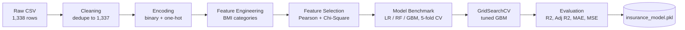

#  Medical Insurance Cost Prediction

**An end-to-end machine learning pipeline that estimates individual medical insurance charges from demographic and lifestyle attributes, using statistically selected features and a tuned Gradient Boosting regressor.**

`Python 3.10+` · `scikit-learn` · `Gradient Boosting` · `Regression` · `Test R² = 0.861`

---

## Table of Contents

1. [Overview](#overview)
2. [Results at a Glance](#results-at-a-glance)
3. [Key Insights](#key-insights)
4. [Methodology](#methodology)
5. [Dataset](#dataset)
6. [Repository Structure](#repository-structure)
7. [Getting Started](#getting-started)
8. [Using the Trained Model](#using-the-trained-model)
9. [Limitations and Future Work](#limitations-and-future-work)
10. [Tech Stack](#tech-stack)
11. [License](#license)
---

## Overview

Insurers price risk. This project asks how far a lean, interpretable feature set can go in predicting what a policyholder will be billed.

PremiumIQ treats a classic regression problem (1,338 policyholders, 6 raw inputs) the way a production ML team would:

- Audit and clean the data
- Engineer features with domain meaning (clinical BMI categories)
- Select features with statistical tests rather than intuition
- Benchmark multiple model families with cross-validation
- Tune the strongest candidate and persist it for reuse

**Outcome:** a Gradient Boosting regressor that explains roughly **86% of the variance** on unseen data and reduces mean absolute error by about **42%** relative to a linear baseline.

| | |
|---|---|
| **Task** | Supervised regression |
| **Target** | `charges` (individual medical costs billed) |
| **Final model** | `GradientBoostingRegressor` (tuned via GridSearchCV) |
| **Evaluation** | Hold-out test set (35%) and 5-fold cross-validation |
| **Primary metric** | R² (with Adjusted R², MAE and MSE reported) |

---

## Results at a Glance

### Model benchmark (5-fold cross-validated R² on training data)

| Model | CV R² |
|---|---|
| Linear Regression (baseline) | 0.741 |
| Random Forest | 0.825 |
| Gradient Boosting (default) | 0.842 |
| **Gradient Boosting (tuned)** | **Selected for final evaluation** |

### Hold-out test performance (468 samples)

| Metric | Linear Regression | **Tuned Gradient Boosting** |
|---|---|---|
| R² | 0.760 | **0.861** |
| Adjusted R² | 0.756 | **0.859** |
| MAE | 4,422 | **2,566** |
| MSE | 41,192,638 | **23,779,166** |

### Best hyperparameters

Found with 5-fold GridSearchCV scored on R².

| Parameter | Value |
|---|---|
| `n_estimators` | 100 |
| `max_depth` | 2 |
| `learning_rate` | 0.1 |

---

## Key Insights

- **Smoking is the dominant cost driver.** Smokers average roughly 32K in charges versus roughly 8.4K for non-smokers.
- **Three features carry the model.** Smoking, BMI and age account for about 99% of total feature importance.
- **Shallow trees win.** The best model uses `max_depth=2`, which suggests the signal comes from a few strong, low-order interactions rather than deep structure.
- **Several statistically significant features add little predictive value.** Sex, region and obesity flag passed the chi-square screen, yet contribute almost nothing once the stronger signals are present.

### Feature importance (tuned Gradient Boosting)

| Feature | Importance |
|---|---|
| `is_smoker` | 68.2% |
| `bmi` | 18.0% |
| `age` | 12.9% |
| `children` | 0.8% |
| `is_male` | < 0.1% |
| `region_southeast` | < 0.1% |
| `bmi_category_Obese` | 0.0% |

---

## Methodology



### 1. Exploratory Data Analysis
Histograms with KDE, categorical counts, box plots for outlier inspection, and a correlation heatmap across numeric variables. No missing values were found, and one duplicate row was removed.

### 2. Preprocessing and Feature Engineering

| Step | Transformation |
|---|---|
| Binary encoding | `sex` to `is_male`, `smoker` to `is_smoker` |
| One-hot encoding | `region` (first category dropped) |
| Domain feature | `bmi` to clinical category: Underweight (<18.5), Normal (18.5 to <25), Overweight (25 to <30), Obese (30+), then one-hot encoded |
| Scaling | `age`, `bmi`, `children` standardized for the selection stage |

### 3. Statistical Feature Selection
`charges` was discretized into quartiles, and each candidate feature was tested against it:

- **Pearson correlation** with the quartile target
- **Chi-square test of independence** at a 0.05 significance level

| Decision | Features |
|---|---|
| Retained | `age`, `bmi`, `is_smoker`, `children`, `is_male`, `region_southeast`, `bmi_category_Obese` |
| Dropped | `region_northwest`, `region_southwest`, `bmi_category_Overweight`, `bmi_category_Normal Weight` |

### 4. Modeling

- **Split:** 65% train / 35% test, `random_state=42`
- **Baseline:** `Pipeline(StandardScaler, LinearRegression)`
- **Challengers:** `RandomForestRegressor`, `GradientBoostingRegressor`
- **Tuning grid:** `n_estimators` in {100, 200, 300}, `max_depth` in {2, 3, 4}, `learning_rate` in {0.1, 0.2, 0.5}

### 5. Persistence
The best estimator is serialized with `joblib` as `insurance_model.pkl`.

---

## Dataset

| Feature | Type | Description |
|---|---|---|
| `age` | int | Age of the primary beneficiary (18 to 64) |
| `sex` | categorical | `male` or `female` |
| `bmi` | float | Body mass index (15.96 to 53.13) |
| `children` | int | Number of covered dependents (0 to 5) |
| `smoker` | categorical | `yes` or `no` |
| `region` | categorical | `northeast`, `northwest`, `southeast`, `southwest` |
| `charges` | float | **Target:** individual medical costs billed by insurance |

1,338 records, 0 missing values, 1 duplicate (removed).

---

## Repository Structure

```
premium-iq/
├── insurance_prediction.ipynb   # Full analysis, modeling and evaluation
├── insurance.csv                # Dataset
├── insurance_model.pkl          # Trained Gradient Boosting model
├── requirements.txt             # Python dependencies
└── README.md
```

---

## Getting Started

```bash
git clone https://github.com/<your-username>/premium-iq.git
cd premium-iq

python -m venv .venv
source .venv/bin/activate        # Windows: .venv\Scripts\activate

pip install -r requirements.txt
jupyter notebook insurance_prediction.ipynb
```

---

## Using the Trained Model

The model expects **exactly these 7 features, in this order**.

```python
import joblib
import pandas as pd

model = joblib.load("insurance_model.pkl")

person = pd.DataFrame([{
    "age": 45,
    "is_smoker": 1,            # 1 = smoker, 0 = non-smoker
    "children": 2,
    "region_southeast": 0,     # 1 if region is southeast
    "is_male": 1,              # 1 = male, 0 = female
    "bmi": 31.5,
    "bmi_category_Obese": 1,   # 1 if BMI >= 30
}])

print(f"Estimated charges: {model.predict(person)[0]:,.0f}")
# Estimated charges: 40,172

person["is_smoker"] = 0
print(f"Same profile, non-smoker: {model.predict(person)[0]:,.0f}")
# Same profile, non-smoker: 9,541
```

> **Compatibility note:** pickled scikit-learn models are version-sensitive. This model was trained with scikit-learn 1.8.x and pandas 3.x. Use matching versions (see `requirements.txt`) to avoid load errors.

---

## Limitations and Future Work

### Known limitations

- **Small dataset.** With 1,338 rows, results may not generalize to real insurer populations.
- **Selection on a binned target.** Quartile discretization discards information; embedded approaches (permutation importance, SHAP, L1 regularization) would be more faithful.
- **Possible leakage.** Scaling and feature selection ran before the train/test split. Moving them inside a cross-validated `Pipeline` would give cleaner estimates.
- **Redundant features.** Several retained features contribute near-zero importance, so a leaner model could perform equally well.
- **Skewed target.** `charges` is right-skewed; a log transform or a Gamma/Tweedie objective may improve fit on high-cost cases.

### Roadmap

- [ ] SHAP-based explainability report
- [ ] XGBoost, LightGBM and CatBoost comparison
- [ ] Residual analysis by smoker and BMI segment
- [ ] Interactive Streamlit app for live predictions
- [ ] Containerized REST API (FastAPI and Docker)

---

## Tech Stack

Python, Pandas, NumPy, Matplotlib, Seaborn, SciPy, scikit-learn, Joblib, Jupyter

---

## License

Distributed under the MIT License. See `LICENSE` for details.

---

## Contributing and Contact

Issues and pull requests are welcome.

**Author:** `SURAJ RAI` |
