<div align="center">


# 🩺 PremiumIQ

### Interpretable Medical Insurance Cost Prediction with Gradient Boosting

*A lean, statistically-selected feature set. A tuned ensemble. A live Streamlit app.*


</div>

---

## Table of Contents

1. [Overview](#overview)
2. [Results at a Glance](#results-at-a-glance)
3. [Key Insights](#key-insights)
4. [Methodology](#methodology)
5. [Dataset](#dataset)
6. [Repository Structure](#repository-structure)
7. [Getting Started](#getting-started)
8. [Run the Web App](#run-the-web-app)
9. [Using the Trained Model](#using-the-trained-model)
10. [Why These Dependencies](#why-these-dependencies)
11. [Limitations and Future Work](#limitations-and-future-work)
12. [Author and License](#author-and-license)

---

## Overview

Insurers price risk. This project asks a focused question: **how far can a small, interpretable feature set go in predicting what a policyholder will be billed?**

PremiumIQ treats a classic regression problem (1,338 policyholders, 6 raw inputs) the way a production ML team would:

- Audit and clean the data
- Engineer features with domain meaning (clinical BMI categories)
- Select features with statistical tests rather than intuition
- Benchmark several model families with cross-validation
- Tune the strongest candidate with `GridSearchCV`
- Persist the model and its feature schema, then serve it through a Streamlit app

**Outcome:** a Gradient Boosting regressor that explains about **89% of the variance** on unseen data and cuts mean absolute error by roughly **40%** against a linear baseline.

| | |
|---|---|
| **Task** | Supervised regression |
| **Target** | `charges` (individual medical costs billed) |
| **Final model** | `GradientBoostingRegressor` (tuned with GridSearchCV) |
| **Evaluation** | 77/23 hold-out split (308 test rows) and 5-fold cross-validation |
| **Primary metric** | R² (Adjusted R², MAE and MSE also reported) |
| **Deployment** | Streamlit app (`app.py`) |

---

## Results at a Glance

### Model benchmark (5-fold cross-validated R², training data)

| Model | CV R² |
|---|---|
| Linear Regression (baseline) | 0.733 |
| Random Forest | 0.808 |
| Gradient Boosting (default) | 0.834 |
| **Gradient Boosting (tuned)** | **0.845** |

### Hold-out test performance (308 samples)

| Metric | Linear Regression | **Tuned Gradient Boosting** |
|---|---|---|
| R² | 0.797 | **0.889** |
| Adjusted R² | 0.792 | **0.886** |
| MAE | 4,266 | **2,550** |
| MSE | 36,347,110 | **19,912,091** |

### Best hyperparameters

Found with 5-fold `GridSearchCV` scored on R² (`random_state=42`).

| Parameter | Value |
|---|---|
| `n_estimators` | 100 |
| `max_depth` | 2 |
| `learning_rate` | 0.1 |

<p align="center">
  
</p>

### Predicted vs. actual

<p align="center">
  
</p>

The model tracks smokers and typical non-smokers closely. Its largest misses are non-smokers with unusually high charges (the points well below the diagonal), a cost driver none of the six inputs can explain.

---

## Key Insights

- **Smoking is the dominant cost driver.** Smokers average about **$32,050** in charges versus about **$8,441** for non-smokers.
- **Three features carry the model.** Smoking, BMI and age account for roughly **99%** of total feature importance.
- **Shallow trees win.** The best model uses `max_depth=2`, which suggests the signal comes from a few strong, low-order interactions rather than deep structure.
- **Statistical significance is not predictive value.** Sex, region and the obesity flag passed the chi-square screen, yet contribute almost nothing once the stronger signals are present.

<p align="center">
  
</p>

### Feature importance (tuned Gradient Boosting)

<p align="center">
  
</p>

| Feature | Importance |
|---|---|
| `is_smoker` | 69.5% |
| `bmi` | 17.6% |
| `age` | 11.8% |
| `children` | 1.0% |
| `is_male` | < 0.1% |
| `region_southeast` | < 0.1% |
| `bmi_category_Obese` | 0.0% |

---

## Methodology

```mermaid
flowchart LR
    A[Raw CSV<br/>1,338 rows] --> B[Cleaning<br/>dedupe to 1,337]
    B --> C[Encoding<br/>binary + one-hot]
    C --> D[Feature Engineering<br/>BMI categories]
    D --> E[Feature Selection<br/>Pearson + Chi-Square]
    E --> F[Model Benchmark<br/>LR / RF / GBM, 5-fold CV]
    F --> G[GridSearchCV<br/>tuned GBM]
    G --> H[Evaluation<br/>R2, Adj R2, MAE, MSE]
    H --> I[(insurance_model.pkl)]
    I --> J[Streamlit App]
```



### 1. Exploratory Data Analysis
Histograms with KDE, categorical counts, box plots for outlier inspection and a correlation heatmap. No missing values were found, and one duplicate row was removed.

<p align="center">
  
</p>

<p align="center">
  
</p>

### 2. Preprocessing and Feature Engineering

| Step | Transformation |
|---|---|
| Binary encoding | `sex` to `is_male`, `smoker` to `is_smoker` |
| One-hot encoding | `region` (first category dropped) |
| Domain feature | `bmi` to clinical category: Underweight (<18.5), Normal (18.5 to <25), Overweight (25 to <30), Obese (30+), then one-hot encoded |
| Scaling | `age`, `bmi`, `children` standardized for the selection stage only |

### 3. Statistical Feature Selection
`charges` was discretized into quartiles, and each candidate feature was tested against it:

- **Pearson correlation** with the quartile target
- **Chi-square test of independence** at a 0.05 significance level

| Decision | Features |
|---|---|
| Retained | `age`, `bmi`, `is_smoker`, `children`, `is_male`, `region_southeast`, `bmi_category_Obese` |
| Dropped | `region_northwest`, `region_southwest`, `bmi_category_Overweight`, `bmi_category_Normal Weight` |

<p align="center">
  
</p>

### 4. Modeling

- **Split:** 77% train / 23% test, `random_state=42`
- **Baseline:** `Pipeline(ColumnTransformer(StandardScaler), LinearRegression)`
- **Challengers:** `RandomForestRegressor`, `GradientBoostingRegressor`
- **Tuning grid:** `n_estimators` in {100, 200, 300}, `max_depth` in {2, 3, 4}, `learning_rate` in {0.1, 0.2, 0.5}

### 5. Persistence
The best estimator is serialized with `joblib` as `insurance_model.pkl`, and the exact feature order as `columns.pkl`. Tree ensembles are scale-invariant, so the final model needs no scaler at inference time.

---

## Dataset

| Feature | Type | Description |
|---|---|---|
| `age` | int | Age of the primary beneficiary (18 to 64) |
| `sex` | categorical | `male` or `female` |
| `bmi` | float | Body mass index (15.96 to 53.13) |
| `children` | int | Number of covered dependents (0 to 5) |
| `smoker` | categorical | `yes` or `no` |
| `region` | categorical | `northeast`, `northwest`, `southeast`, `southwest` |
| `charges` | float | **Target:** individual medical costs billed by insurance |

1,338 records, 0 missing values, 1 duplicate (removed), leaving 1,337 for modeling.

---

## Repository Structure

```
premium-iq/
├── app.py                       # Streamlit app for live predictions
├── insurance_prediction.ipynb   # Full analysis, modeling and evaluation
├── insurance.csv                # Dataset
├── insurance_model.pkl          # Trained Gradient Boosting model
├── columns.pkl                  # Feature names in the order the model expects
├── assets/                      # Figures used in this README
├── requirements.txt             # Python dependencies (with rationale)
├── LICENSE                      # MIT License
└── README.md
```

---

## Getting Started

```bash
git clone https://github.com/<your-username>/premium-iq.git
cd premium-iq

python -m venv .venv
source .venv/bin/activate        # Windows: .venv\Scripts\activate

pip install -r requirements.txt
jupyter notebook insurance_prediction.ipynb
```

> **Compatibility note:** pickled scikit-learn models are version-sensitive. `insurance_model.pkl` was serialized with **scikit-learn 1.9.0**, which is why `requirements.txt` pins that exact version. Python 3.11+ is required by pandas 3.x.

---

## Run the Web App

```bash
streamlit run app.py
```

<p align="center">
  
</p>

Enter age, sex, BMI, dependents, smoking status and region, then click **Predict** to get an estimated yearly charge. Inputs are restricted to the ranges the model was trained on (age 18 to 64, children 0 to 5).

---

## Using the Trained Model

The model expects **exactly these 7 features, in this order** (also stored in `columns.pkl`).

```python
import joblib
import pandas as pd

model = joblib.load("insurance_model.pkl")
columns = joblib.load("columns.pkl")

person = pd.DataFrame([{
    "age": 45,
    "is_smoker": 1,            # 1 = smoker, 0 = non-smoker
    "children": 2,
    "region_southeast": 0,     # 1 if region is southeast
    "is_male": 1,              # 1 = male, 0 = female
    "bmi": 31.5,
    "bmi_category_Obese": 1,   # 1 if BMI >= 30
}])[columns]

print(f"Estimated charges: {model.predict(person)[0]:,.0f}")
# Estimated charges: 41,583

person["is_smoker"] = 0
print(f"Same profile, non-smoker: {model.predict(person)[0]:,.0f}")
# Same profile, non-smoker: 9,764
```

---

## Why These Dependencies

| Package | Why it is here |
|---|---|
| `scikit-learn==1.9.0` | Model training, `GridSearchCV`, metrics, and loading the pickled model. Pinned because pickles are version-sensitive. |
| `pandas>=3.0` | Cleaning, one-hot encoding (`get_dummies`), BMI binning (`cut`) and target quartiles (`qcut`). |
| `numpy>=2.0` | Numerical foundation for pandas and scikit-learn. |
| `scipy` | Pearson correlation and chi-square test of independence for feature selection. |
| `joblib` | Efficient serialization of the model and column schema. |
| `streamlit` | Turns the model into an interactive web app with no frontend code. |
| `matplotlib`, `seaborn` | EDA visuals: distributions, outlier box plots, correlation heatmap. |
| `jupyter` | Runs the analysis notebook end to end. |

---

## Limitations and Future Work

### Known limitations

- **Small dataset.** With 1,338 rows, results may not generalize to real insurer populations.
- **Selection on a binned target.** Quartile discretization discards information; embedded approaches (permutation importance, SHAP, L1 regularization) would be more faithful.
- **Possible leakage.** Scaling and feature selection ran on the full dataset before the train/test split. Moving them inside a cross-validated `Pipeline` would give cleaner estimates.
- **Redundant features.** Several retained features contribute near-zero importance, so a leaner model (smoker, BMI, age, children) would likely perform equally well.
- **Skewed target.** `charges` is right-skewed; a log transform or a Gamma/Tweedie objective may improve fit on high-cost cases.
- **Not a pricing tool.** Predictions reflect one public dataset and are for educational use only.

### Roadmap

- [ ] SHAP-based explainability report
- [ ] XGBoost, LightGBM and CatBoost comparison
- [ ] Residual analysis by smoker and BMI segment
- [x] Interactive Streamlit app for live predictions
- [ ] Containerized REST API (FastAPI and Docker)

---

## Author and License

**Author:** Suraj Rai

<div align="center">

*If you found this useful, consider giving the repo a ⭐*

</div>
